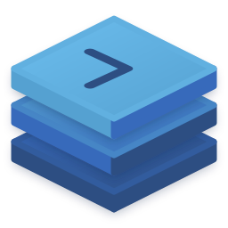

<div id="top"></div>

[![Contributors][contributors-shield]][contributors-url]
[![Forks][forks-shield]][forks-url]
[![Stargazers][stars-shield]][stars-url]
[![Issues][issues-shield]][issues-url]
[![GNU Affero General Public License v3.0 License][license-shield]][license-url]

<div align="center">
  
  <h3 align="center">Kontext</h3>
  <p align="center">
    Mission control for AI-assisted development on Windows: GitHub issues, isolated git worktrees and embedded Claude Code terminals in one app.
    <br />
    <a href="https://github.com/jellebuning/kontext/issues">Report Bug</a>
    ·
    <a href="https://github.com/jellebuning/kontext/issues">Request Feature</a>
  </p>
</div>

<!-- TABLE OF CONTENTS -->
<details>
  <summary>Table of Contents</summary>
  <ol>
    <li>
      <a href="#about-the-project">About The Project</a>
      <ul>
        <li><a href="#features">Features</a></li>
        <li><a href="#built-with">Built With</a></li>
      </ul>
    </li>
    <li>
      <a href="#getting-started">Getting Started</a>
      <ul>
        <li><a href="#requirements">Requirements</a></li>
        <li><a href="#build-and-run">Build and run</a></li>
        <li><a href="#test">Test</a></li>
      </ul>
    </li>
    <li><a href="#contributing">Contributing</a></li>
    <li><a href="#license">License</a></li>
  </ol>
</details>


## About The Project

Kontext lets you work on all your repositories' issues at once and leave Claude running. Pick an issue and Kontext gives it its own git worktree and an embedded Claude Code terminal, lets you open that worktree in your own tools, and lets you switch between issues instantly. The sidebar shows at a glance which issues are idle, working or waiting for you.

### Features

* **Every issue in one list.** Open issues from all your repositories, grouped by repository, searchable, with a status circle per issue.
* **One worktree per issue.** Selecting an issue clones the repository when needed, creates a `features/{number}-{title}` branch in its own worktree, and opens an empty Claude Code session there. Nothing is asked of you, and nothing is shared between issues.
* **Know when Claude needs you.** Claude Code hooks report whether a session is working or waiting for input; the circle in the sidebar changes accordingly.
* **Resume where you left off.** Sessions are remembered per issue and continued with `claude --resume` after a restart.
* **Open it anywhere.** Open a worktree in File Explorer, Windows Terminal or Visual Studio from the issue's header.
* **Clean up when done.** For a closed issue, Clear session removes the worktree and its branch.
* **Modern Architecture:** Built with SOLID principles and design patterns for maximum maintainability: a modular monolith with compiler-enforced module boundaries.
* **Native Windows look.** WinUI 3 with Mica, light and dark themes, and a terminal with zoom and mouse support.

### Built With

* [.NET 10](https://dotnet.microsoft.com/) and [WinUI 3 / Windows App SDK](https://learn.microsoft.com/windows/apps/windows-app-sdk/)
* [CommunityToolkit.Mvvm](https://learn.microsoft.com/dotnet/communitytoolkit/mvvm/) and `Microsoft.Extensions.Hosting` (dependency injection)
* [CommunityToolkit Labs MarkdownTextBlock](https://github.com/CommunityToolkit/Labs-Windows) for the issue descriptions
* [Octokit](https://github.com/octokit/octokit.net) for GitHub
* [EasyWindowsTerminalControl](https://github.com/mitchcapper/EasyWindowsTerminalControl) for the embedded terminal
* [NUnit](https://nunit.org/) for tests

Three small shared projects hold what the modules exchange (`Kontext.Kernel` the basics, `Kontext.Domain` the data types, `Kontext.Contracts` the interfaces). Each feature module (GitHub, GitAutomation, TerminalHost, Claude, ExternalTools, Sessions, Presentation) references only those, and only the WinUI project `Kontext` references them all and wires them together.

## Getting Started
Setting up this solution on your local machine is straightforward and will enable you to fully utilize its capabilities. This guide will walk you through the necessary steps to get everything running smoothly.

Before beginning, ensure that your development environment is properly configured. Having the required software and dependencies installed will prevent common issues and streamline the process.

### Requirements

* Windows 10 version 1809 or later (Windows 11 recommended)
* [.NET 10 SDK](https://dotnet.microsoft.com/download)
* [Git for Windows](https://git-scm.com/download/win) on your `PATH`
* The [Claude Code](https://docs.claude.com/en/docs/claude-code) CLI (`claude`) on your `PATH`
* A GitHub personal access token with the `repo` scope; Kontext asks for it on first start and stores it in Windows Credential Locker

### Build and run

```powershell
dotnet build Kontext.slnx -c Release
.\src\Kontext\bin\Release\net10.0-windows10.0.19041.0\win-x64\Kontext.exe
```

Stop a running instance before building again, because it locks the build output. Kontext keeps its clones, worktrees and state under `%LOCALAPPDATA%\Kontext`; set `KONTEXT_DATA_DIR` to use another folder, for example when trying things out.

### Test

```powershell
dotnet test Kontext.slnx -c Release
```

Warnings are treated as errors. The tests include integration tests that run real `git` against a temporary repository.

<!-- CONTRIBUTING -->
## Contributing

Contributions are what make the open source community such an amazing place to learn, inspire, and create. Any contributions you make are **greatly appreciated**.

If you have a suggestion that would make this better, please fork the repo and create a pull request. You can also simply open an issue with the tag "enhancement".
Don't forget to give the project a star! Thanks again!

1. Fork the Project
2. Create your Feature Branch (`git checkout -b features/feature-title`)
3. Commit your Changes (`git commit -m 'Added feature'`)
4. Push to the Branch (`git push origin features/feature-title`)
5. Open a Pull Request

Keep the module boundaries described under [Built With](#built-with): every module references only the shared projects, and `tests/Kontext.ArchitectureTests` enforces it.


<!-- LICENSE -->
## License
Distributed under the GNU Affero General Public License v3.0 License. See `LICENSE` for more information.


<p align="right">(<a href="#top">back to top</a>)</p>


<!-- MARKDOWN LINKS & IMAGES -->
<!-- https://www.markdownguide.org/basic-syntax/#reference-style-links -->
[contributors-shield]: https://img.shields.io/github/contributors/jellebuning/kontext.svg?style=for-the-badge
[contributors-url]: https://github.com/jellebuning/kontext/graphs/contributors
[forks-shield]: https://img.shields.io/github/forks/jellebuning/kontext.svg?style=for-the-badge
[forks-url]: https://github.com/jellebuning/kontext/network/members
[stars-shield]: https://img.shields.io/github/stars/jellebuning/kontext.svg?style=for-the-badge
[stars-url]: https://github.com/jellebuning/kontext/stargazers
[issues-shield]: https://img.shields.io/github/issues/jellebuning/kontext.svg?style=for-the-badge
[issues-url]: https://github.com/jellebuning/kontext/issues
[license-shield]: https://img.shields.io/github/license/jellebuning/kontext.svg?style=for-the-badge
[license-url]: https://github.com/jellebuning/kontext/blob/main/LICENSE
